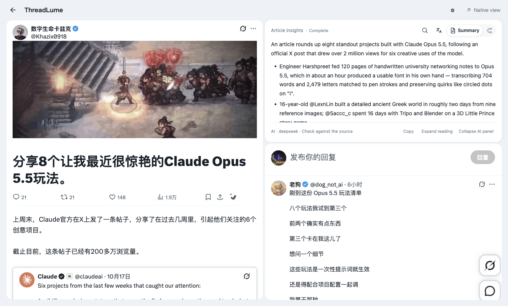
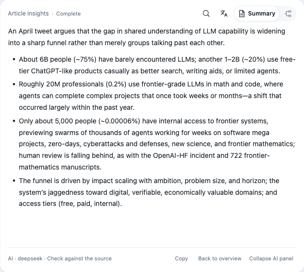
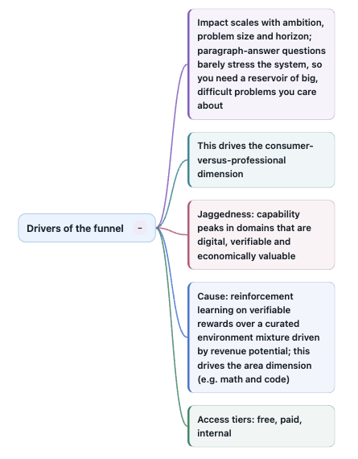
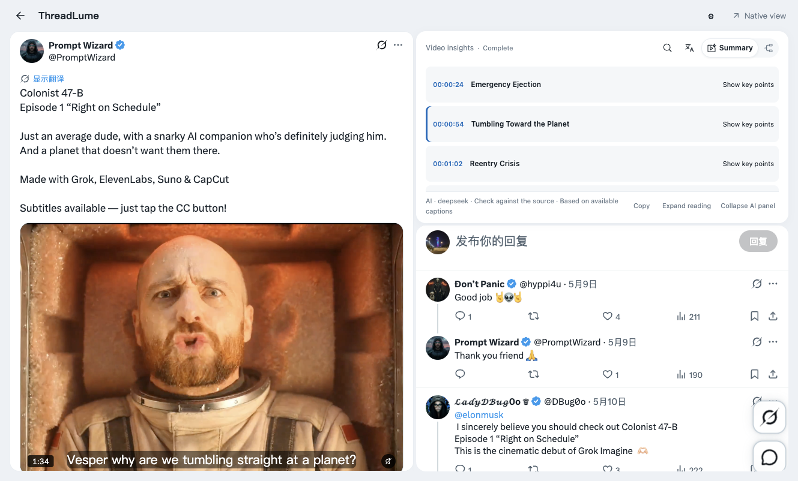

<picture><source media="(prefers-color-scheme: dark)" srcset="public/brand/logo-dark.svg"></picture>

<strong>Read Beyond the Post.</strong> AI summaries, interactive mind maps and video chapters, right beside the original X post.

**English** · [简体中文](README.zh-CN.md)

[Download preview](https://github.com/devon-kong/ThreadLume/releases) · [See it in use](#see-it-in-use) · [Install](#installation)

https://github.com/user-attachments/assets/41f6f284-f99a-4dd9-9912-e6faaac70f3e

**38-second product demo** · Side-by-side reading, chapter jumps, progressive summaries and mind maps. Real browser captures with music and on-screen text. [Download the original MP4](https://github.com/devon-kong/ThreadLume/releases/download/v0.12.0/ThreadLume-demo-38s.mp4) · [Sources and demo notes](docs/demo.md).

Turn long X posts and captioned videos into clear summaries, interactive mind maps, and clickable chapters—while keeping the original content and conversation in view.

**Desktop Chromium preview.** Basic reading works without AI setup. AI features require your own compatible API service and are subject to that service's charges. Install the ZIP as an unpacked extension; no Node.js or build tools are needed.

## See it in use

**Read the post and its conversation together**

Keep the original text, media and native comments in a focused two-column view.

**Find the main points**

Read a structured summary beside its source, then copy it for your notes.

**Explore the structure**

Expand a branch to inspect its details, zoom in, or copy the map as an outline.

A detail of one expanded branch:

**Return to a moment in the video**

Generate chapters from available native captions, then click a timestamp to seek in the original player. Available captions may cover only part of the video.

These are real browser captures. See [capture sources and release conditions](docs/validation.md#screenshot-provenance) and the [latest showcase checks](docs/showcase-validation.md).

## What you can do

- **Read in context:** use X's original post, media and comments, then return to the timeline.
- **Summarize and organize:** turn eligible long content into a summary, a mind map or video chapters.
- **Keep control:** stop generation, retry when you choose and reuse completed results. Optional streaming lets you read provisional results as they arrive.
- **Use your own AI service:** configure a compatible HTTPS Chat Completions endpoint and model.
- **Choose your language and theme:** English or Simplified Chinese controls, a separate AI output language, and light or dark appearance.

## Installation

1. [Download the extension ZIP from the latest preview release](https://github.com/devon-kong/ThreadLume/releases) and extract it into a folder you will keep.
2. Open `chrome://extensions/` in a desktop Chromium browser and enable **Developer mode**.
3. Choose **Load unpacked** and select the extracted folder containing `manifest.json`.
4. Refresh your X tabs and open a post to try the reader.

**Start with basic reading; connect AI when you need it.** Open ThreadLume Settings → **Add AI service**, enter your service details and choose **Save, test & enable**. The test sends a minimal prompt, not the current article.

Once connected, opening eligible content automatically generates the selected AI view. Choosing the other view can send another request. Article text or available captions are sent to your selected service; provider billing and data policies apply.

[Detailed setup, updates and troubleshooting](docs/installation.md) · [Privacy and data handling](PRIVACY.md)

## Before you try it

- Use a desktop window at least 980 CSS pixels wide for the AI panel.
- Video AI uses available native captions; it does not transcribe audio. Short posts and videos without usable captions do not generate AI results.
- Check AI output against the source. Quality, response time and compatibility depend on your service and model.
- X layout changes can interrupt the reader. You can return to X's native view; the extension does not initiate X private HTTP API requests.

ThreadLume is an independent project, not affiliated with or endorsed by X Corp.

## For developers

The extension uses Manifest V3, JavaScript and CSS, with one build output: `dist-extension-native/`.

[Build from source](docs/installation.md#build-from-source) · [Architecture](docs/architecture.md) · [Engineering case study](docs/case-study.md) · [Validation](docs/validation.md)

## Project information

[Contributing](CONTRIBUTING.md) · [Security](SECURITY.md) · [Privacy](PRIVACY.md) · [Changelog](CHANGELOG.md)

Code is distributed under the [MIT License](LICENSE). Copyright notices are retained; dependency and source acknowledgements are in [Third-party notices](THIRD_PARTY_NOTICES.md). X and Twitter are trademarks of their respective owners.
