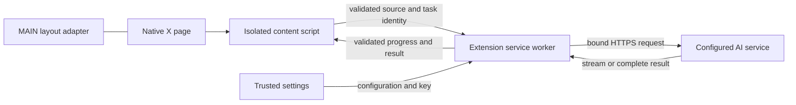

# Architecture

ThreadLume is a Manifest V3 extension built with vanilla JavaScript and CSS. esbuild produces one unpacked artifact. No hosted application backend is required.

## Boundaries

The MAIN adapter owns layout only. It does not import AI modules, make network requests or access keys. It is constrained by the [layout contract](architecture/layout-adapter-contract.md).

The isolated content script reads the focused article or available standard TextTrack cues. It renders extension-owned controls and result panels, while the original post, media and comments retain native identity. Requests are scoped to the originating document, frame, focused post and reader instance. The worker confirms focus against the live content script before admitting generation.

Settings are the only context allowed to edit provider configuration or keys. A reader message can change only the output-language enum. The internal `peek-ai-v7` message namespace and historical storage identifiers remain stable for upgrade compatibility; these are not public third-party APIs.

## Binding and execution

A candidate service is normalized and validated, its specific host grant is checked, and the selected transport policy is prepared. A minimal model test must succeed before versioned key records and a registry commit pointer publish the candidate. A failed or cancelled test preserves the previous active service and draft.

Generation uses that bound executor directly. The standard policy uses fixed HTTPS POST Chat Completions with omitted cookies and rejected redirects. The one existing Yuanjing exception uses an exact-endpoint, extension-scoped session rule to remove Origin. There is no provider fallback or automatic model retry.

The former Doubao bridge is removed. Old connection records are retained without restoration. In production, no legacy request transport is supplied: absent custom configuration reports `AI_NOT_CONFIGURED` or `DOUBAO_UNAVAILABLE`. Offline compatibility tests can exercise retained legacy parsers and lifecycle helpers with injected synthetic transports; that is not a shipped connection route.

## Rendering and lifecycle

The selected view is generated first; the other view is on demand. Completed views have independent caches. Streaming previews are validated before rendering and remain visibly incomplete until final validation. Markdown is rendered with safe DOM elements; raw HTML cannot create executable content or remote resources.

Tasks own cancellation, progress sequence and document identity. Late results cannot overwrite a newer post, language, service or cancelled task. A stopped post stays stopped across focus and visibility changes. Model failures are presented with an explicit recovery action.

Interface language and AI output language are independent. Interface updates preserve result nodes and do not start model work. Output language is persisted through a narrow validated message and participates in the cache key.

## Verification

`npm test` rebuilds the artifact and runs Native regressions. Build and isolation tests separately scan the X-facing bundles for forbidden network/credential capabilities. Unit and integration tests use explicit browser/network doubles. Real service and browser evidence is reported separately in [Validation](validation.md).

## Setup observations and caption normalization

Connection diagnostics use a separate trusted-settings interface and bounded local history. Each save/activation carries an operation ID; startup and permission-event recovery have independent IDs. Rule calls retain their original promises and mutation ownership. Observations do not change permission admission, retry, binding or recovery policy, and diagnostic storage failure must not delay a connection attempt. Diagnostics remain readable while model/rule initialization is pending.

Native subtitle cues are read through `getCueAsHTML().textContent`, with a temporary native `VTTCue` parser as fallback. Detached fragments are never rendered. If neither parser is usable, the original text is retained. This removes X word-timing markup before request size checks while preserving cue order and timestamps. Existing input limits still apply; local oversize errors are distinct from provider-side length rejection. Native cue availability is a snapshot, not a universal guarantee of a complete transcript.
