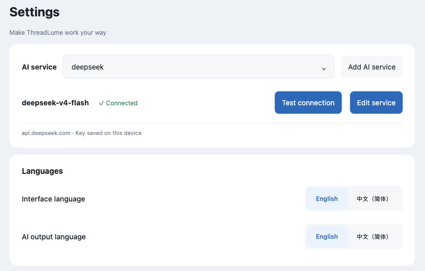

# Install and connect ThreadLume

## Install the preview ZIP

No Node.js or developer tools are needed to use the packaged preview.

1. Open [Releases](https://github.com/devon-kong/ThreadLume/releases) and download the extension ZIP from **Assets**, rather than GitHub's source-code archive.
2. Extract it into a permanent folder. Find the folder that directly contains `manifest.json`.
3. Open `chrome://extensions/`, enable **Developer mode**, choose **Load unpacked**, and select that folder.
4. Refresh any existing X tabs and open a post. Basic reading works without an AI service.

The downloadable ZIP reflects its tagged release. Changes on `main` reach the ZIP only when a new package is released. For the latest source changes, use the build instructions below. See [release validation](validation.md) and [follow-up checks](showcase-validation.md) for the scope of each result.

## Connect your AI service

Open the extension's Settings and choose **Add AI service**.



Enter the service name, HTTPS Base URL, model identifier and API key supplied by your provider. ThreadLume supports the Chat Completions protocol; a provider having an API does not by itself establish compatibility.

- **Remember on this device** keeps the key in browser-local extension storage, not the system keychain. With it off, the key lasts only for the browser session.
- **Save, test & enable** requests access to the configured service host and sends a minimal compatibility prompt. It does not send the current article. The test can still incur provider usage.
- A successful test enables the service. Opening eligible content then generates the selected view automatically; selecting a second view may send another request.
- Streaming is optional and checked during service setup. A failed request does not silently switch provider or retry.

Article text or available native caption cues, potentially including the title and public URL, are sent to the selected provider. See [Privacy](../PRIVACY.md).

The interface language and AI output language are independent. Changing the interface language does not generate content. Output languages have separate result caches.

## Update an existing installation

Extract the new package into the same installation folder, or rebuild your existing source checkout. In `chrome://extensions/`, reload ThreadLume, then refresh X tabs. Keep the installation folder and browser profile stable to retain the extension identity and its local settings.

A new folder or browser profile does not automatically receive saved settings or API keys. Configure the service through Settings; never copy credentials into an issue report.

## If something needs attention

| What you see | Next action |
| --- | --- |
| The folder cannot be loaded | Select the extracted directory containing `manifest.json`, not the ZIP or its parent folder. |
| X looks unchanged after installation or update | Reload the extension and refresh X. Confirm it is enabled and has site access. |
| AI panel is missing | Use a window at least 980 CSS pixels wide and an eligible long post or captioned video; check that the AI views are enabled. |
| No usable video captions | Enable captions through X's player if available. ThreadLume does not transcribe audio or guarantee full-video caption coverage. |
| Connection test fails | Follow the displayed error; check the provider's Base URL, model, key and host permission. A failed test preserves the previous working service. |
| A session-only key is no longer available | Open **Edit service** and enter the key again. |
| A legacy Doubao connection is unavailable | Add a compatible API service. Old data remains local, but the retired bridge cannot connect or generate content. |
| X changes break the reader | Use **Native view** and report the page URL, browser version and reproduction steps without credentials. |

## Build from source

Use Node.js 22.12+ and npm.

```sh
git clone https://github.com/devon-kong/ThreadLume.git
cd ThreadLume
npm ci
npm run build
```

Load `dist-extension-native/` in `chrome://extensions/`, then refresh X. All three build commands produce this same directory; there is no second extension artifact.

```sh
npm test              # build, isolation checks and Native regression suite
npm run build:current # same output as npm run build
npm run build:native  # same output as npm run build
```

`native-extension/` contains the product, `tests/native/` the regression suite, `scripts/` the build tools, and `docs/` current documentation. Dependencies and build output are not committed.

## 简体中文快速设置

1. 从 [Releases](https://github.com/devon-kong/ThreadLume/releases) 的 **Assets** 下载扩展 ZIP，不是 GitHub 自动提供的源码压缩包。
2. 解压到长期保留的目录，在 `chrome://extensions/` 开启开发者模式，加载包含 `manifest.json` 的目录。
3. 刷新 X 标签页，先体验基础阅读。无需安装 Node.js。
4. 需要 AI 时，在设置中点击「添加 AI 服务」，填写服务商提供的 HTTPS Base URL、模型标识和 Key，然后「保存、检测并启用」。检测不发送当前文章，但可能产生供应商用量。
5. 连接后，符合条件的内容会自动生成当前视图，正文或可用字幕会发送给所选服务。界面语言和 AI 输出语言分别设置。

「记住此设备」使用浏览器本地扩展存储，不是系统钥匙串；关闭后，Key 仅保留在浏览器会话中。不要把 Key 发到问题报告里。

更新时保留相同安装目录，重载扩展并刷新 X。新目录或新浏览器配置不会自动继承旧设置。Release ZIP 对应其发布标签；主分支的新改动需要发布新包后才会进入下载版。

若 AI 面板不出现，检查窗口是否至少 980 CSS 像素宽、AI 视图是否开启、内容是否为长文或具有可用原生字幕的视频。连接失败按界面提示检查地址、模型、Key 和域名权限。旧豆包连接仅保留迁移提示，请添加兼容 API 服务继续使用。
