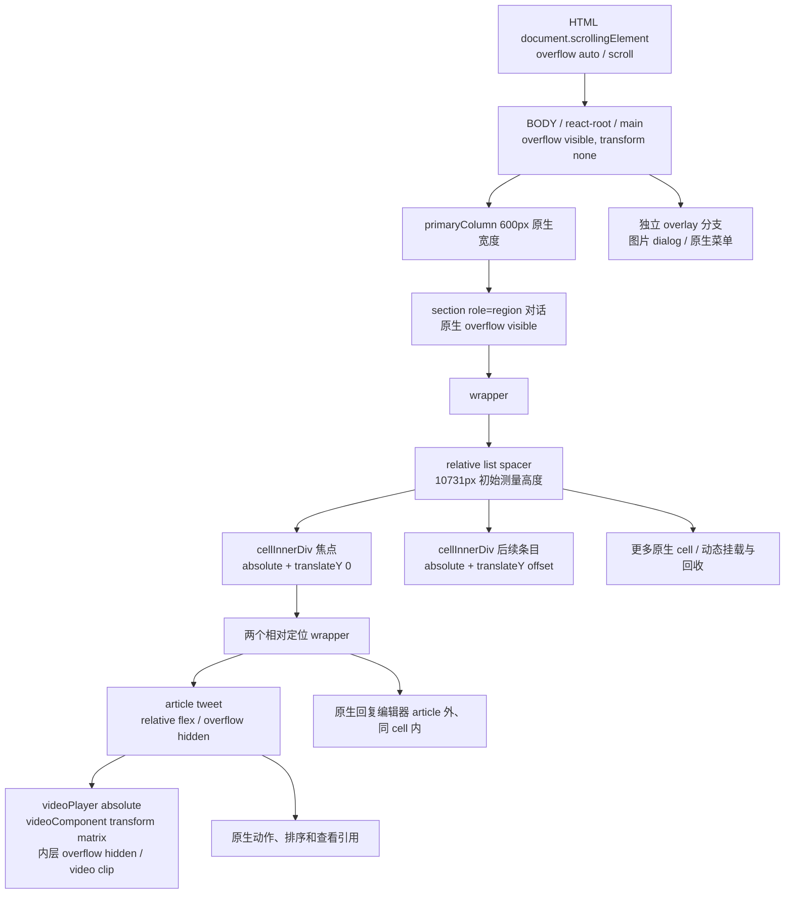

# S0 — X 原生 DOM / 滚动结构

2026-10-13，EgoBrowser TaskSpace 19，登录页面，只读 DOM 与可恢复 CSS。原有 Peek Native 0.9.0 通过扩展管理 UI 暂停后刷新；`s0-video.json` 的 extensionPanes=0。未读取 Fiber、Webpack、认证或响应正文。

## 实测结构

来自 `evidence/s0-video.json` 的 tag、testid、computed style、bounding rect 与 scrollHeight/clientHeight；不是凭 class 或截图推断。

焦点 article 原生约 598×918.5，cell 598×1003.5；文章和编辑器同一 cell。后续 article 与焦点属于同一个 DOM 虚拟列表容器，共享 HTML/window 滚动。React 数据模型未反射读取；“同虚拟列表”依据同父 absolute cells、滚动时 cell 集合变化和真实节点卸载，而非内部对象猜测。

## 必答结论

1. **同一列表 / 同一原生滚动容器：是（所测详情页）。** 焦点不是独立于评论虚拟化的永久头部。
2. **CSS 能独立定位：能暂时做到。** cell 的 transform 即使是 identity matrix，也建立 fixed 包含块；A 对当前焦点 cell 覆盖 `transform:none`，article fixed 到 viewport 左侧并设置 overflow-y:auto。DOM 父子关系保持。
3. **深滚后保持挂载：不能。** A 的真实视频样本右栏滚到实际 2732px 后 article/cell/video disconnected；不是视觉裁切。具体见 scrolling-and-virtualization。
4. **position/transform 是否影响虚拟化：影响几何和测量。** article 出正常流后焦点 cell 缩小，列表重新计算；原生渲染集合没有获得“永久保留焦点”的语义。不能从 CSS 推断组件生命周期。
5. **播放器依赖：** videoPlayer absolute、多个定位祖先和裁切 wrapper、videoComponent 上 transform；native fullscreen 使用浏览器顶层全屏，进入成功，原生退出按钮成功；自动化 Escape 未退出的事实保留。进度拖动未验证成功，不能声称完整控制链通过。
6. **裁切限制：** 原始 article overflow hidden，内部媒体多层 overflow hidden/clip；链上本次未见 contain 或 filter 非 none。后续 X 版本/其他媒体不能泛化。
7. **Portal/Overlay：** 图片 dialog 的祖先链在独立页面分支，含 fixed 包装，不在 focal article；打开时 X 自己把 HTML overflow 改为 hidden。探针未改 HTML/body overflow。Esc 先关图片，carrier 仍 active。菜单在 article 外，测量捕获到高度 0 的动画初态，未把该数据判成可用 PASS；HoverCard 未观察到。
8. **响应式：** 原生 600px 中栏与多层固定宽度 wrapper；直接给 primaryColumn 加 margin 导致横向溢出，初始实现改用 M1-R 同类的 100vw 中栏、每 cell 52vw margin /48vw width，main 左对齐。1440、1280、1000 均测；这些是实验 CSS，不是已验收响应式产品。<960 推荐降级原生单栏，未实现发布逻辑。

## Grid / Flex / sticky 的边界

焦点与回复的 article 不是适合直接分配到两个 grid area 的同级永久节点；它们位于各自受管理 cell 内。对外层 grid/flex 不能改变被回收的 cell 的存在性；display:contents 也不能给组件保留生命周期。sticky 仍受 cell/list 的几何和存活期限制；fixed 能脱离视觉流，但不能脱离 React 卸载。没有因 fixed 失败就堆叠 sticky、巨大占位或伪造高度；这些会污染虚拟列表几何并缺乏稳定的保留契约。

以上是对当前已测结构的有界 NO-GO，不是对所有可能 CSS 方案的数学不可能性证明。
