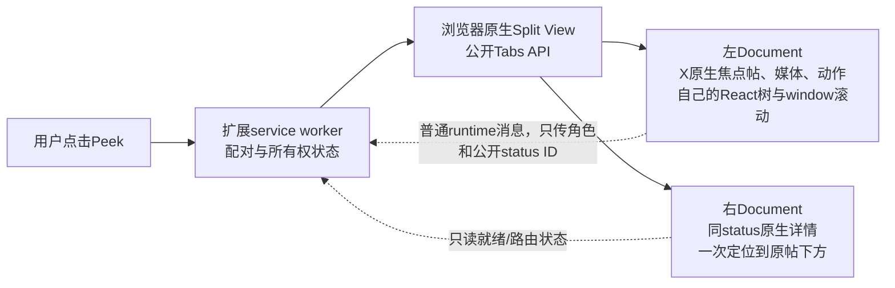

# Peek 候选 C：两个原生页面承载双栏

2026-10-13。**值得继续，结论为 PARTIAL / 进入下一轮原型的 CONDITIONAL GO；不是产品验收通过。** 所测样本中，右页虚拟列表回收未卸载左页节点；当前环境未完成真正同时可见分屏，因此不能宣称视频连续播放、完整双栏或真实MV3通过。

用户此次明确允许研究两个可见原生页面、额外的正常X原生请求、浏览器分屏/窗口形态。其余禁止事项保留。研究分支 `codex/peek-native-m2c-dual-page` 从B0归档提交27ad2b1起；正式产品源码仍是M1-R，无集成M2-A。

## 1. 新发现：存在官方MV3分屏API路线

直接读取Chrome官方正文及API参考（不是仅依据搜索摘要）：

- [Enhance multitasking extensions with the new Tabs Split View API](https://developer.chrome.com/blog/split-view-api-extensions)，页面标注2026-09-16更新：Chrome145已有手动Split View；**扩展创建/管理Split View API从Chrome155提供**。
- [Tabs API](https://developer.chrome.com/docs/extensions/reference/api/tabs)：`chrome.tabs.createSplit([leftId,rightId])`、`chrome.tabs.create({url,splitWithTabId:leftId})`、`chrome.tabs.unsplit(splitViewId)`。
- 官方说明这些分屏方法本身不需要权限；使用`chrome.tabs`命名空间不等于必须申请`"tabs"`权限。X专用host权限可支持匹配页面的URL访问；角色控制可走静态content_script与runtime messaging，不需要cookie/webRequest/DNR。

两tab必须相邻、同windowId/pinned/groupId、尚未被分屏；创建新tab的`splitWithTabId`更适合一次性建立配对。Chrome140+的`Tab.splitViewId`字段不代表140可调用createSplit；判断方法可用性应以155标注和运行时feature detection为准。

最小方向（示意，**尚未在MV3运行**）：

```js
if (typeof chrome.tabs.createSplit !== 'function' ||
    typeof chrome.tabs.unsplit !== 'function') {
  return { supported: false, reason: 'Native split API unavailable' };
}
// publicStatusUrl must be a validated x.com/twitter.com status URL.
// Source must be a suitable, unsplit, ungrouped/unpinned tab for this first spike.
const right = await chrome.tabs.create({
  url: publicStatusUrl,
  windowId: left.windowId,
  index: left.index + 1,
  splitWithTabId: left.id,
  active: true,
});
```

**这修正了前一轮讨论中的限制判断：两个原生页面可以放在同一个浏览器窗口，且不必用iframe。** 但那是浏览器级Split View，不是一个网页DOM内的Peek浮层，也没有已核实的API让扩展强制52:48、隐藏浏览器边框或做跨两页的单一悬浮header。

当前Ego UA为Chrome/152；版本低于官方createSplit起点。没有升级浏览器、修改flags、调用内部接口或安装新扩展。本次未在扩展上下文亲测`typeof chrome.tabs.createSplit`，因此运行时支持状态仍需最终能力检测，不能仅用UA代替。

## 2. 原生文档隔离已实测

样本与详细数据见 `evidence/document-isolation.json`、`evidence/article-relative-scroll.json`。

- 两页通过普通公开status URL分别由X自行加载；没有克隆DOM、移动节点、iframe、React内部调用或主动API。
- **视频样本：右页深滚8000px后自身焦点article/video断开；左页的同一个article、同一个video和原parent均保留，readyState=4，解码尺寸1472×1472。** 左页滚动位置162px保持不变。这直接区别于A/B：所测右列表的回收没有影响左Document的组件。浏览器discard、内存压力、reload、左页自身滚动和播放器策略仍可能结束其生命周期。
- 左页独立500ms采样的实际时间线记录了`visibilityState=hidden`；X把后台视频暂停，currentTime停在约0.02468s。重新观察左页会激活它，结束时paused=false不能冒充整个过程持续播放。
- **Article样本：左页4662字符原生正文保持同一article、scrollY=10。** 首批绝对滚动步长曾回到右页长文章内部，不能算评论区测试；保留该原始数据，并只做一次相对于article底部的有界修正：右页到11077px时原帖断开、最终13477px，左页仍保留同一4662字符article和原parent。
- DOM的`seenArticles`只是唯一原生article集合计数，不是已验证真实回复数或分页次数。没有读GraphQL响应证明祖先关系。

## 3. 当前容器测试的明确限制

Ego受控TaskSpace20中创建了两个任务所属tab。原有Peek扩展临时禁用，以免污染页面布局。通过原生UI检查了Tab菜单；未成功打开分屏，Move Tab to New Window操作后两页仍报告相同windowId。只操作本轮tab，没有关闭/移动用户原有tab。

公开CDP `Browser.getWindowForTarget`可读窗口信息；`Target.createTarget`创建新窗口被工具明确拒绝为`not allowed`，不绕过。`Browser.getVersion`也不可用，版本以页面UA记录。故**实际结果是两个普通tab，而不是并排可见窗口**。每次页面工具调用可能激活目标页，单次读到visible/hasFocus=true不证明两个同时可见；独立时间线反而证明左页在右侧操作时hidden。

本轮不把当前环境无法分屏判为候选C的生命周期失败，也不把普通tab的DOM隔离判为完整双栏通过。

## 4. 建议的C架构



第一版只在用户主动打开一个未分组、未固定、未分屏的X详情页时创建一个右tab。现有详情页作为左页，以避免重新加载其播放器；右页通过自己的X会话自然加载详情，不复制/重放左页请求。

右页从article下方开始，保留原生composer。定位需要等当前status自己的详情结构确认，再以真实DOM边界一次性定位；迟到Article/媒体、用户开始滚动/输入、超时、路由变化都要有界取消，不能持续把用户拉回。M2-A仍是NO-GO，不直接复用其实现。

只做一次定位意味着用户向上滚动仍能看到右页原帖；如果产品要求“永远不能重新看到”，则属于另一个需求，需要独立验证右页隐藏/缩短焦点cell对虚拟化的影响。初版建议不隐藏、不截断原生节点。

左页也仍是完整原生详情页，用户自己滚过文章底部会进入左页的评论；若要左页只允许原帖，同样是后续产品规则，不能通过本次隔离测试自动认定解决。

## 5. 成本与新风险

1. **两个页面不是一个播放器实例。** 两页初始均可能创建同帖播放器；右页滚走后通常暂停/卸载，但初始媒体请求、解码、广告及脚本有额外开销。不能声称“零重复播放器”或只靠缓存保证零成本。
2. **两套前端状态。** 登录会话相同不保证点赞/收藏计数立即跨页一致。本轮无账号写入，实时同步未测。禁止为了同步再主动调用私有API，也不伪造确认状态。
3. **路由漂移。** 右边进入某条回复后，左边应保留用户原来阅读的原帖；不要无条件双向同步地址。切换新的主帖才显式重建配对。
4. **关闭与恢复。** 持有“扩展创建的右tab”的明确所有权；unsplit/关闭只清理该tab，不能关用户左页。如果右页已被用户导航用于其他工作，应解除配对而非强关。service worker休眠/重启要能恢复或安全放弃。
5. **全屏、图片、Esc、焦点。** 两个document各自原生处理；浏览器全屏可能暂时遮住另一侧。退出恢复、点击右侧是否影响左播放、后台/最小化、焦点迁移均尚未在同时可见容器里验收。
6. **资源。** 本轮ResourceTiming几乎未捕获完整资源且跨源transferSize=0，不能计算“多一倍流量”。JS heap快照只能辅助定位，不等于进程RSS，也不能直接相加作严格内存比较。
7. **兼容。** Chrome155+公开API优先；145–154可以把手动分屏作为人工试验入口，不承诺一键创建。旧版本并排窗口是另一种降级形态，当前工具未实测成功。版本不足应说明原因，不悄悄改回iframe或开启隐藏页。

## 6. Gate 与下一步

| 项目 | 结果 |
|---|---|
| 两个原生React树与虚拟列表隔离 | PASS，有限视频/Article文档实测 |
| 右深滚不卸载左原帖/播放器 | PASS，视频8000px样本；不等于持续播放 |
| 左右真正同时可见且独滚 | NOT_TESTED，容器未建立 |
| 左视频在右操作时连续播放 | NOT_TESTED；普通tab后台暂停已观察 |
| 原生全文/媒体/交互完整性 | PARTIAL，保留原生结构；完整专项未测 |
| 原帖视觉只一次 | PARTIAL，右初始滚走；仍可向上找回 |
| 官方MV3承载API | 文档已确认；当前运行时调用未测 |
| 零主动私有请求/鉴权/内部补丁 | PASS，研究代码源码范围 |
| 性能与额外请求可接受 | NOT_TESTED，不能给性能GO |
| 实际MV3安装 | NOT_TESTED |

**推荐下一阶段：在具备公开Split View API的Chrome155+环境做独立C1原型。** 先用运行时feature detection确认API，随后只实现“建立两页配对＋右侧一次定位＋安全关闭”。先过同时可见/媒体连续播放/分页/资源成本四个Gate，再做界面收窄、同步或其他功能。无需重写X播放器，也不必侵入其React生命周期。

若现在必须在当前Ego152交付一键Peek浮层，本研究不能证明可交付；不能把Chrome155官方文档当成当前环境已支持。M1-R与Legacy继续原样保留，B0 A/B仍NO-GO。


## 独立审查与验证

独立Reviewer直接阅读官方摘录、两个DOM数据集、Article修正数据与源码，结论：**同意PARTIAL；仅对Chrome155+有界原型给CONDITIONAL GO**，不能给产品、连续播放、性能或真实MV3的GO。Reviewer核对视频右焦点在4200px已断开、Article在11077px已断开，同时左页原节点保留；确认hidden/paused证据未被误标持续播放。未发现主动请求、认证/React内部操作或账户写入。

两探针脚本通过node --check；正式Native/Legacy/demo源码和既有构建/测试均未修改，本轮不重复旧全套测试作为新架构通过的装饰。原有Peek扩展与任务空间在结束时恢复/清理，见environment.json。

下一阶段先确认真正分屏建立和同时visible，再测试右栏持续操作时左媒体连续播放。不要跳过此Gate直接移植完整Peek界面。
